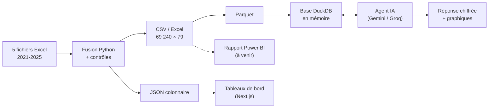

# Parcoursup 2021-2025 : synthèse d'avancement et prototype

**Projet de data visualisation · M2 · point d'étape du 28 septembre 2026**

| | |
|---|---|
| Application en ligne | https://projet-dataviz-xi.vercel.app |
| Galerie des graphiques de l'agent | https://projet-dataviz-xi.vercel.app/assistant/graphiques |
| Code source | https://github.com/azizbelhadjsayar/projet_dataviz |

---

## 1. En bref

Le projet analyse les données ouvertes Parcoursup sur cinq sessions (2021 à 2025). Il comporte trois volets :

1. **Une base de données fusionnée et contrôlée** : les 5 fichiers annuels du ministère réunis en une seule table de 69 240 lignes × 79 colonnes.
2. **Une application web de tableaux de bord** : vue d'ensemble, formations, territoires, profils des admis, recherche d'une formation.
3. **Un agent d'analyse IA** : il répond aux questions en langage naturel en écrivant et en exécutant lui-même ses requêtes SQL sur les données, puis en produisant les graphiques adaptés.

Le prototype est **complet et déployé**. Il reste l'intégration d'un rapport Power BI : la page d'accueil de ce rapport est prête dans l'application.

## 2. État d'avancement

| Volet | État | Livrable |
|---|---|---|
| Fusion et contrôle des données | Terminé | `scripts/01_fusion_parcoursup.py`, `Data/processed/` |
| Tableaux de bord (6 pages) | Terminé | Application Next.js (`web/`) |
| Agent d'analyse IA | Terminé (prototype) | Page « Agent d'analyse » |
| Graphiques de l'agent (20 types) | Terminé | Galerie `/assistant/graphiques` |
| Historique et mémoire des conversations | Terminé | Conversations conservées dans le navigateur |
| Mise en ligne | Terminé | Vercel, redéploiement automatique à chaque modification |
| Rapport Power BI | À faire | Page d'intégration prête (lien à renseigner) |

## 3. Les données

### Source

Jeu de données open data « Parcoursup : vœux de poursuite d'études et admissions » du ministère de l'Enseignement supérieur : un fichier Excel par session, 118 colonnes chacun.

### Difficultés rencontrées et traitements

- **Colonnes dans un ordre différent** entre 2021 et 2022-2025. Elles sont associées **par nom**, jamais par position.
- **Deux colonnes homonymes** « Filière de formation » dont le sens est inversé entre 2021 et les sessions suivantes. Elles sont distinguées automatiquement (filière agrégée d'un côté, intitulé détaillé de l'autre).
- **Libellés hétérogènes** : régions (« Centre » → « Centre-Val de Loire », « Grand-Est » → « Grand Est »…), académies, types de formation. La région manquante en 2024-2025 (Polynésie, étranger) est déduite de l'académie.
- **Colonnes retirées** : pourcentages (recalculés à partir des effectifs), colonnes techniques, doublons. Il reste **79 colonnes pertinentes**, décrites dans un dictionnaire.
- **Contrôles automatiques** : le nombre de lignes, la somme de chaque effectif et le nombre de valeurs non nulles sont comparés aux fichiers sources. La clé (session, formation) est vérifiée unique.

### Volume

| | |
|---|---|
| Lignes (une formation pour une session) | 69 240 |
| Formations distinctes sur 5 ans | 16 355 |
| Établissements | 4 372 |
| Types de formation · filières · académies | 11 · 59 · 33 |

| Session | Formations | Places | Vœux (phase principale) | Admis | Taux d'accès moyen* |
|---|---:|---:|---:|---:|---:|
| 2021 | 13 396 | 766 905 | 11 481 505 | 652 449 | 40,3 %** |
| 2022 | 13 644 | 766 205 | 11 573 473 | 635 308 | 45,0 % |
| 2023 | 13 869 | 771 221 | 11 800 517 | 638 078 | 46,2 % |
| 2024 | 14 079 | 770 362 | 11 825 691 | 649 547 | 44,7 % |
| 2025 | 14 252 | 769 351 | 13 052 197 | 660 752 | 40,0 % |

\* Moyenne pondérée par les vœux. \*\* Définition source différente en 2021 : comparaison avec 2022 et après à prendre avec prudence.

### Formats produits à partir de la même base

- **CSV et Excel** (avec le dictionnaire) : pour Power BI et les analyses externes.
- **JSON colonnaire compact** : pour les tableaux de bord.
- **Parquet** : pour la base SQL de l'agent.

## 4. Le prototype

### 4.1 Architecture



### 4.2 Tableaux de bord

Toutes les pages ont en commun :
- une barre de filtres : session, type de formation, secteur, sélectivité, région ;
- sur chaque graphique, une **vue tableau** (accessibilité), un **export CSV** et, sur la plupart, un raccourci « Analyser » qui ouvre l'agent avec une question pré-remplie ;
- un thème clair / sombre et un affichage adapté au mobile.

| Page | Contenu |
|---|---|
| **Vue d'ensemble** | Chiffres clés avec variation et mini-courbe ; demande, offre et admissions en indice base 100 ; taux d'accès par session ; répartition des vœux et accès par type de formation ; faits saillants rédigés automatiquement |
| **Formations & sélectivité** | Nuage de points demande par place × taux d'accès (une filière par point) ; filières les plus demandées et les moins accessibles ; tableau triable de toutes les filières |
| **Territoires** | Carte de France (régions ou départements, outre-mer en encarts, classes de quantiles) pour 10 indicateurs ; classement ; fiche détaillée au clic |
| **Profils & équité** | Origine scolaire des vœux et des admis ; mentions au bac ; accès des boursiers et des non-boursiers ; part des filles ; évolution de la mixité ; propositions reçues avant le bac |
| **Explorer** | Recherche parmi les formations ; fiche 2021-2025 d'une formation (places, vœux, admis, taux d'accès, comparaison à sa filière) ; lien vers la fiche Parcoursup |
| **Données & méthode** | Chaîne de traitement, définitions des indicateurs, précautions de lecture |

### 4.3 Agent d'analyse IA

Ce n'est pas un simple chatbot : c'est un **agent autonome** qui mène l'analyse lui-même, jusqu'à 12 étapes par question :

1. il comprend la question et annonce son plan ;
2. il **écrit et exécute ses propres requêtes SQL** sur la table complète (DuckDB) ;
3. il lit les résultats d'un œil critique, corrige ses erreurs de requête et approfondit (évolution, comparaison public / privé, corrélations…) ;
4. il crée les graphiques utiles ;
5. il conclut avec les chiffres clés, l'interprétation, les limites, et propose des questions de relance.

Toutes les étapes s'affichent en direct : les requêtes SQL, leurs résultats, puis les graphiques. Le raisonnement reste ainsi **vérifiable**.

**Fiabilité des chiffres**
- L'agent reçoit le schéma des 79 colonnes, les valeurs possibles des colonnes catégorielles et des **recettes de calcul** des indicateurs (toujours des ratios de sommes, jamais des moyennes de ratios).
- Il reçoit aussi les **précautions de lecture** (un vœu n'est pas un candidat, définition 2021 différente…).
- Consigne stricte : chaque chiffre cité doit provenir d'une requête.
- Garde-fous automatiques, par exemple le rejet d'un taux supérieur à 100 %, typique d'une erreur d'unité.

**Sécurité**
- Seules les requêtes de lecture (`SELECT`) sont acceptées, après vérification par l'analyseur SQL.
- Accès aux fichiers et au réseau désactivé.
- Durée et nombre de lignes plafonnés.

**Conversations**
- Historique conservé dans le navigateur, avec recherche, épinglage et titres automatiques.
- Reprise d'une conversation avec sa mémoire : les derniers échanges sont repris en entier, les plus anciens sous forme de résumé mis à jour en arrière-plan. Le contexte garde donc une taille constante.

**Modèles**
- Services gratuits : Google Gemini Flash (principal) et Groq (secours).
- Plusieurs clés d'API utilisées à tour de rôle.
- Bascule automatique vers un autre modèle en cas de quota atteint ou de panne, y compris au milieu d'une analyse.

### 4.4 Graphiques produits par l'agent

L'agent choisit le graphique selon le besoin exprimé :

| Besoin | Graphiques |
|---|---|
| Classer, comparer | Barres horizontales triées, colonnes |
| Évolution | Courbes, aires empilées |
| Part d'un tout | Anneau (≤ 6 parts), treemap (un ou deux niveaux), barres et colonnes à 100 %, barres empilées |
| Avant / après | Haltères (deux valeurs reliées par catégorie) |
| Décomposer un écart | Cascade (départ, variations, arrivée) |
| Étapes d'une procédure | Entonnoir (vœux → propositions → admis) |
| Distribution | Histogramme |
| Relation entre indicateurs | Nuage de points, bulles (3ᵉ indicateur en taille) |
| Deux unités différentes | Graphique combiné en panneaux alignés (pas de double axe) |
| Territoires | Carte des régions ou des départements |
| Croisement de deux dimensions | Carte de chaleur |
| Synthèse | Tuiles de chiffres clés avec variation et mini-courbe |

Trois dimensions supplémentaires peuvent s'y ajouter, comme dans Tableau ou Power BI : une **couleur** (3ᵉ dimension), des **petits multiples** (un panneau par année, par exemple, avec une échelle commune) et une **taille** (bulles).

**Règles de conception appliquées**
- Palette catégorielle de 6 teintes, **validée par script** : séparation pour les daltonismes, contraste sur fond clair et sombre.
- Au-delà de 6 catégories, regroupement en « Autres » plutôt que des couleurs recyclées.
- Une même entité garde toujours la même couleur (Public / Privé, par exemple).
- Pas de graphique à double axe.
- Échelle séquentielle à une seule teinte pour les cartes, paire divergente bleu / rouge pour les hausses et les baisses.
- Vue tableau et export CSV pour chaque graphique.

La **galerie** montre 22 exemples construits sur les vraies données, avec les mêmes paramètres que l'agent, sans appeler de modèle. Elle reste consultable même si les quotas gratuits sont épuisés.

## 5. Premiers enseignements

Constats tirés des données. Les interprétations restent à approfondir.

- **La demande augmente plus vite que l'offre.** Les vœux en phase principale passent de 11,5 M (2021) à 13,1 M (2025) : **+13,7 %**, dont +10,4 % sur la seule dernière année. Sur la même période, le nombre de places reste stable : 766 905 puis 769 351 (+0,3 %). La pression passe ainsi de **15,0 à 17,0 vœux par place**. Une partie de la hausse peut venir de l'élargissement de l'offre sur la plateforme (+6,4 % de formations).
- **L'accès se resserre.** Le taux d'accès moyen pondéré baisse de 45,0 % (2022) à **40,0 % (2025)**. La valeur 2021 n'est pas comparable (définition différente).
- **Profil scolaire très contrasté selon les filières.** Parmi les admis néo-bacheliers de 2025 dont la mention est connue, **43,5 % ont une mention très bien en CPGE**, contre 8,2 % en licence et environ 4 % en BTS et en BUT.
- **Origine scolaire des admis 2025** (bacs général, technologique et professionnel) : 68,4 % bac général, 19,5 % technologique, 12,2 % professionnel.
- **Les vœux se concentrent sur trois types de formation.** Sur cinq ans : licence (13,7 M de vœux), BTS (11,2 M) et formations en soins infirmiers (7,2 M).

## 6. Scénario de démonstration proposé (10 minutes environ)

1. **Vue d'ensemble** (1 min) : chiffres clés 2025, changement de session, puis filtre « Privé » pour montrer la réactivité.
2. **Territoires** (1 min) : carte de la pression par région, bascule vers les départements, clic sur un territoire.
3. **Explorer** (1 min) : recherche d'une formation connue et sa fiche 2021-2025.
4. **Agent d'analyse** (5 min), avec des questions qui montrent son autonomie :
   - « Quelles sont les formations les plus sélectives en 2025 ? »
   - « D'où vient la hausse des vœux entre 2021 et 2025 ? Décompose par type de formation. » (cascade)
   - « Montre sur une carte la pression par département en 2025. »
   - Une question de relance (« et dans le privé seulement ? ») pour montrer la mémoire de la conversation.
5. **Galerie des graphiques** (1 min) : l'éventail des 20 types.
6. **Données & méthode** (1 min) : fusion, contrôles, précautions de lecture.

*Solution de repli :* si un quota gratuit est atteint pendant la démonstration, la galerie et les tableaux de bord fonctionnent sans appel au modèle.

## 7. Qualité et tests

- **Tests des graphiques** : les 22 exemples de la galerie et 8 cas limites, sur les vraies données. Les cas limites incluent les erreurs attendues : taux multiplié par 100, carte par académie, carte avec plusieurs années par territoire, etc.
- **Tests de la chaîne de modèles** sans consommer de quota (faux serveurs locaux) : bascule entre fournisseurs, quotas par minute et par jour, rotation des clés, réponses interrompues.
- **Vérification de types (TypeScript) et analyse statique (ESLint)** à chaque modification.
- **Contrôles de la fusion** : sommes et nombres de valeurs non nulles identiques aux sources.

## 8. Limites connues

- **Quotas des services gratuits** : Gemini a un quota journalier par modèle, Groq un débit limité par minute. En cas de forte utilisation, l'agent bascule vers des modèles plus légers, et ses réponses peuvent alors être plus lentes ou moins approfondies.
- **Un modèle de langage peut se tromper** : les requêtes étant affichées, chaque chiffre reste vérifiable, mais une relecture humaine reste nécessaire pour toute conclusion.
- **Nature des données** :
  - un vœu n'est pas un candidat ;
  - le périmètre des formations change d'une année à l'autre ;
  - le taux d'accès 2021 repose sur une autre définition.
- **Accès public** : l'application en ligne n'est pas protégée par un code d'accès. N'importe qui peut donc consommer les quotas de l'agent.

## 9. Prochaines étapes

1. **Rapport Power BI** construit sur le fichier Excel fusionné, puis intégré dans la page prévue de l'application.
2. Selon vos retours : approfondissement de certaines analyses (équité sociale, mobilité géographique, évolution par filière).
3. Éventuellement, un code d'accès pour protéger l'agent pendant la période d'évaluation.

---

## Annexe : technologies et organisation du dépôt

| Domaine | Technologies |
|---|---|
| Préparation des données | Python, pandas |
| Application | Next.js 16, React 19, TypeScript, Tailwind CSS |
| Graphiques | Recharts, composants SVG / HTML sur mesure, d3-geo (projection des cartes) |
| Base de l'agent | DuckDB (en mémoire, fichier Parquet) |
| Modèles de langage | Google Gemini Flash, Groq (gpt-oss) ; API compatible OpenAI |
| Hébergement | Vercel (région Paris), déploiement continu depuis GitHub |

```
Data/
  2021.xlsx … 2025.xlsx         fichiers sources
  processed/                    base fusionnée (CSV, Excel) + dictionnaire des colonnes
scripts/
  01_fusion_parcoursup.py       fusion, harmonisation, contrôles
  02_export_app_data.py         export pour les tableaux de bord
web/                            application (pages, agent, graphiques, tests)
```
